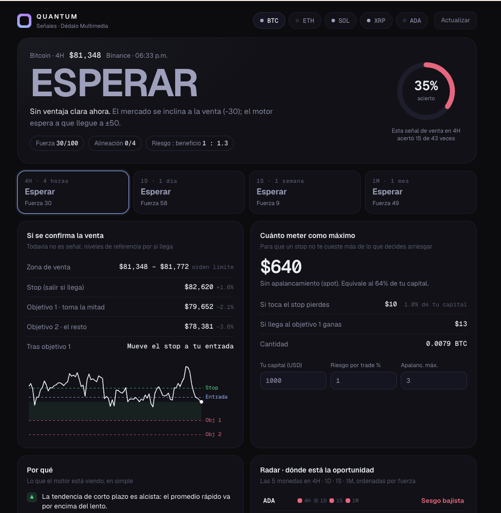

# QUANTUM Signals

**Quant crypto signals: a pattern model estimates the probability of every trade, proves itself on data it never saw, and only then says BUY or SELL.**

**[▶ Live demo](https://dedalomultimedia.com/trading/quantum-senales.html)** · [Español](#español)

## How it decides (Simons-style, no human opinion)

1. **11 factors per candle**: trend, momentum, RSI, MACD, Bollinger position, volatility, range position and volume, all normalized by volatility.
2. **Pattern memory**: a k-nearest-neighbors search finds the most similar moments in that market's history, plus a regularized logistic regression.
3. **Probability**: their average estimates the chance of hitting target 1 (2 ATR) before the stop (1.5 ATR).
4. **Out-of-sample test**: trained on the first 70% of history, tested on the last 30%. If it doesn't beat break-even (42.9%) there, it stays on WAIT.
5. **Filters**: probability ≥ 55%, positive expected value, price not already moved (no chasing), higher timeframe not against it.
6. **Sizing**: risk = min(your limit, ¼ Kelly). Position = risk / distance to stop, capped by your max leverage.

## What you see

- **BUY / SELL / WAIT** for BTC, ETH, SOL, XRP and ADA on 4H, 1D, 1W and 1M
- Probability, expected value and validation status
- Trade ticket: entry zone, stop, two targets, max position, one-click copy
- **Engine view**: animated flow from 20 markets to signals, with every rejection and its reason
- Radar heatmap, factor weights, out-of-sample equity curve
- **Live track record**: every strong signal is logged and graded automatically
- Telegram alerts (page open) or **24/7** with the PHP bot
- English / Spanish, SEO, AEO and structured data

## 24/7 Telegram bot

1. Create a bot with **@BotFather** and get your chat ID with **@userinfobot**.
2. Edit the top of `quantum-alertas.php`: token, chat ID, `$SECRET`, language.
3. Upload it next to the page and test: `quantum-alertas.php?key=YOUR_KEY&test=1`
4. Cron every 15 minutes: `php /path/to/quantum-alertas.php > /dev/null 2>&1`

The bot writes `quantum-journal.json`; the page reads it to show the real 24/7 track record.

> Never commit your real bot token to a public repo.

## Disclaimer

Educational quantitative tool. Probabilities come from past data and do not guarantee future results. Not financial advice. Renaissance Technologies' real models are secret; this is a transparent, simplified take on the same principles.

---

## Español

**Señales cripto cuantitativas: un modelo de patrones estima la probabilidad de cada operación, se prueba con datos que nunca vio y solo entonces dice COMPRAR o VENDER.**

- 11 factores por vela, vecinos más cercanos + regresión logística
- Validación fuera de muestra (70/30); si no supera el equilibrio, dice ESPERAR
- Filtros: probabilidad ≥ 55%, valor esperado positivo, no perseguir precio, temporalidad mayor no en contra
- Tamaño por Kelly fraccional (¼) con tu límite de riesgo
- Embudo de rechazos, radar, pesos de factores, historial real calificado solo
- Alertas a Telegram 24/7 con el robot PHP (`$LANG = 'es'`)

Herramienta educativa. No es asesoría financiera.

---

Made by [Dédalo Multimedia](https://dedalomultimedia.com) · If this helped you, leave a ⭐
